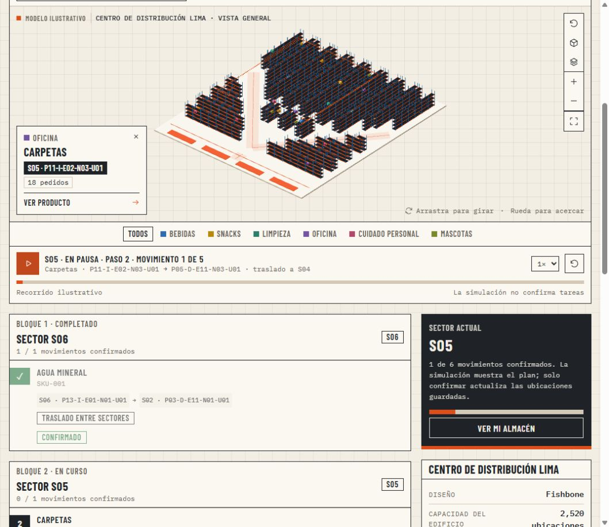

# Kbit Slot

Prototipo personal de software para explorar un almacén en 3D, simular reubicaciones y ejecutar tareas. Proyecto separado de `kbit-ibm/demo`; el repositorio original no se modifica.



**Demostración rápida:** abre `dist/Kbit-Slot.html` en un navegador y entra en **Diseñar almacén**. Elige una plantilla, ajusta estantes y niveles y guarda el diseño para verlo en **Mi almacén**. La animación, el plano y las tareas utilizan ese mismo almacén, con un catálogo de demostración colocado en sus direcciones.

## Diseñador de almacenes


- Cuatro geometrías: **Paralelo, Flying-V, Fishbone y Chevron**. Cambiar de tipo conserva las cantidades, niveles, huecos y medidas del borrador.
- Configura pasillos o filas por zona/ala, estantes por lado, niveles, huecos y uno o ambos lados. Ajusta ancho de pasillos, ancho y fondo de estantes, altura entre niveles y separación de accesos.
- Flying-V y Fishbone añaden **Profundidad de la V**; Chevron añade **Ángulo de las filas**. El edificio y su superficie se ajustan a la geometría.
- La capacidad cuenta los módulos que realmente caben. Se dejan libres las vías diagonales y los huecos de acceso; los estantes junto a los bordes de Fishbone pueden ser más cortos.
- La capacidad, superficie estimada y altura se actualizan junto al modelo 3D. Cambia a plano 2D, vista superior o perspectiva; gira, acerca y selecciona estantes.
- Por encima de 400 estantes se muestra una vista por sectores. Entra en uno desde el modelo o el selector para ver hasta 80 estantes detallados.
- Cada ubicación tiene una dirección estable: `P09-I-E11-N06-U03` identifica pasillo, lado, estante, nivel y hueco.
- **Guardar diseño** lo aplica a Mi almacén y lo conserva en este navegador. **Volver al diseño guardado** descarta el borrador; cambiar de página o de tema conserva el borrador válido durante la sesión.

El modelo representa una sola planta. Las cajas ilustran el espacio: no representan inventario ni ocupación real. La superficie incluye márgenes y una zona de empaque ilustrativa; no es un plano constructivo ni una validación normativa. Se admiten hasta 64 pasillos o filas por zona/ala, 100 módulos por fila, 12 niveles y 6 huecos por nivel. El total depende de la geometría y sus accesos. Esto valida la representación visual, no el rendimiento de un WMS u optimizador industrial.

Los diseños anteriores (Compacto, Distribución, Fulfillment y Estantería alta) se abren automáticamente como **Paralelo** con sus medidas y direcciones originales. Ver [modelo de las cuatro geometrías](docs/warehouse-layouts.md).

El diseño guardado alimenta la operación: se colocan hasta 30 SKUs de demostración en una muestra de hasta 64 direcciones reales. El motor calcula distancias por las vías de esa geometría y genera el mismo plan para la animación y las tareas. Cada configuración conserva sus pedidos, plan y confirmaciones por separado. Ver [operación sobre el diseño guardado](docs/warehouse-operation.md).

## Experiencia visual 3D

- Almacén ilustrativo con estantes, cajas, pasillos, zona de empaque y una carretilla de referencia.
- Arrastra para girar, usa la rueda o los botones para acercarte y cambia entre vista isométrica y superior.
- Amplía el almacén; usa la X o Escape para volver a la aplicación.
- Selecciona una caja o elige un producto en el buscador para consultar su ubicación y presencia en pedidos.
- Activa **Conexiones** para ver productos que se piden juntos y su frecuencia.
- Activa **Demanda** para colorear los productos por presencia en pedidos; la leyenda muestra la escala.
- Filtra por familia para destacar un grupo de productos.
- Reproduce, pausa, acelera (1×, 2×, 3×) y reinicia la simulación. Las cajas recorren una secuencia ilustrativa de movimientos, incluidos los pasos temporales.
- Cambia a **Plano** para ver los productos sobre la geometría guardada y consultar sus direcciones completas.
- Alterna **Tema oscuro / Tema claro** desde la cabecera; la escena 3D usa los mismos colores del tema y la preferencia se guarda en el navegador.

La reproducción usa las rutas del grafo de circulación del diseño guardado; no confirma movimientos ni modifica las tareas del turno. Las tareas se agrupan por sector y solo se confirma el siguiente paso permitido. La geometría y las rutas son un modelo ilustrativo, sin equipos, tráfico ni restricciones de un almacén físico. La experiencia está centrada en el frontend, con datos y estado locales. Requiere WebGL para 3D; el plano 2D permite continuar cuando WebGL no está disponible.

## Abrir

La forma más sencilla: abre **`dist/Kbit-Slot.html`** en tu navegador. Es un archivo independiente, con el diseño, la tipografía y la aplicación incluidos. No requiere instalación.

Para trabajar con los archivos de desarrollo, necesitas Node.js, sin instalar dependencias:

```powershell
npm start
```

Abre http://127.0.0.1:4173. La persistencia al abrir archivos locales depende de ese navegador. Regenera el archivo independiente con `npm run export` después de editar el proyecto.

## Flujo para presentar

Con un diseño guardado, la operación usa sus ubicaciones. En diseños Paralelo de hasta 2.000 ubicaciones puedes elegir **Completa** para optimizar sobre todas ellas, con hasta 150 SKUs de ejemplo (ver `docs/warehouse-operation.md`).


1. **Diseñar almacén:** elige una de las cuatro geometrías, ajusta sus medidas y guarda. **Mi almacén** coloca hasta 30 productos de ejemplo en direcciones de ese diseño.
2. **Preparar turno:** limita los productos reubicados, fija productos y, si lo necesitas, conserva los productos de limpieza en sus sectores actuales.
3. **Generar plan:** calcula una propuesta (con barra de avance y opción de cancelar), compara la distribución actual con la propuesta y revisa los productos reubicados. Debajo, **Lo que cambia en el piso** muestra el recorrido de picking por pedido antes y después, el recorrido del montacargas y los pares que más se acercan; **Calidad de la solución**, la cota inferior y la brecha máxima al óptimo, el tiempo, las evaluaciones, la curva de convergencia y, a pedido, la variación con otras semillas.
4. **Tareas:** reproduce el mismo plan sobre tu almacén, revisa los bloques por sector y confirma movimientos en secuencia. Los destinos están libres; la reserva temporal tiene una dirección del diseño.
5. **Historial:** el turno completado se registra. Recarga para verificar que tu estado se conserva.

En Ayuda puedes reiniciar la demostración. La importación CSV acepta `order_id,sku` o `pedido_id,producto_id`, con separador coma o punto y coma. Cada pedido puede ocupar varias filas; los SKUs corresponden al catálogo de ejemplo (SKU-001 a SKU-030). Se admiten hasta 2 MB y 5.000 filas. Se puede descargar un CSV de ejemplo, el catálogo y las tareas.

## Alcance

- Prototipo funcional de una aplicación web, sin servidor de negocio. El archivo independiente y la carpeta `dist/` ya incluyen el motor visual empaquetado; no requieren instalar paquetes para usarlos.
- Los cálculos son reales sobre los pedidos activos. El motor clásico parte de una búsqueda voraz (intercambios y movimientos a posiciones libres), la refina con 32 cadenas de recocido simulado y pule el mejor resultado. Evalúa cada movimiento de forma incremental, corre en un Web Worker para no congelar la página y con la misma semilla da el mismo plan. En pruebas con pedidos sintéticos queda en promedio a menos de 0,4 % de referencias casi óptimas (la búsqueda voraz sola, entre 3 % y 11 %), en unos 160 ms. No garantiza el óptimo global: cada plan trae una cota inferior demostrada y la brecha máxima, y el motor exacto del servicio (MILP, hasta 14 productos movibles) demuestra el óptimo en problemas pequeños. Las tareas usan el mínimo de pasos y se ordenan para acortar el recorrido del montacargas.
- El índice suma, una vez por par, la frecuencia de aparición conjunta × distancia por pasillos. En el diseño guardado, las distancias proceden de sus pasillos, cruces y vías diagonales, más acceso al estante y diferencia de altura, según las medidas configuradas. El ejemplo heredado de 4 × 8 conserva sus distancias en unidades del plano.
- El límite cuenta SKUs cuya ubicación final cambia; una reubicación puede necesitar pasos temporales adicionales.
- Una dirección de la muestra queda reservada para movimientos temporales. La regla de limpieza conserva cada producto en su sector actual. En el ejemplo heredado se mantienen D08 y la zona D.
- El porcentaje es mejora del índice, no ahorro de tiempo, dinero o productividad comprobado.
- Catálogo, plano y pedidos iniciales son sintéticos. La importación cambia solo los pedidos, manteniendo el plano y el catálogo demo.
- Persistencia en `localStorage`, separada por navegador y origen. Los archivos CSV se procesan localmente. El historial y las confirmaciones no se sincronizan con otros usuarios.
- No incluye WMS, inventario de cantidades, autenticación ni lectores QR. El servicio opcional de Qiskit se describe abajo; no convierte la muestra visual en una optimización de todo un edificio industrial.

## Servicio de cálculo y Qiskit (opcional)

Un servicio en Python agrega tres motores a «Preparar turno»: el mismo cálculo clásico en el servidor, uno exacto (MILP con HiGHS, para problemas pequeños) y un híbrido QAOA de Qiskit, con bloques de intercambios, ventanas con corrección Húngara o ambos. Corre sobre simuladores ideales (Statevector, Aer statevector, Aer MPS), sobre equipos de IBM simulados con su ruido o sobre hardware real de IBM. Ver `docs/QISKIT.md`.

```bash
python -m venv .venv
.venv/bin/pip install -r server/requirements.txt
.venv/bin/python -m server                                   # http://127.0.0.1:8000
.venv/bin/python -m server.diagnose --device fake_torino     # ¿qué tamaño de bloque resiste el ruido?
.venv/bin/python -m server.benchmark                         # clásico, QAOA y controles; resultados en results/
```

Abre http://127.0.0.1:8000. Desde el archivo independiente, pulsa «Conectar» bajo «Motor de cálculo» en Preparar turno. El híbrido muestra su resultado junto a la referencia clásica: a esta escala no supera al recocido del navegador, y el benchmark lo compara también con el mismo procedimiento usando muestras al azar. El hardware de IBM requiere una cuenta y `KBIT_API_KEY`; consume tiempo de QPU.

## Estructura

- `dist/index.html`: estructura de la aplicación.
- `dist/styles.css`: diseño responsive tipo plancha de despacho: tokens de color claro y oscuro, papel milimetrado, paneles con rótulo y tablero de solapas.
- `dist/app.js`: navegación, reglas, tareas, importación, exportación e historial.
- `dist/visual-ui.js` y `dist/visual.css`: controles, selección, capas y reproductor visual.
- `src/warehouse3d.js`: escena Three.js, interacción, cámara, iluminación y animación.
- `src/layout3d.js`: vista compartida del diseño, con geometría instanciada, selección y detalle por sectores.
- `src/operation3d.js`: productos y rutas animadas sobre esa misma vista.
- `dist/operation-model.js`: ubicaciones activas, grafo de circulación, distancias y agrupación de tareas.
- `dist/operation-ui.js`: plano de productos, bloques por sector y datos del almacén guardado.
- `dist/layout-model.js`: validación, capacidad, geometría lógica, sectores y direcciones.
- `dist/designer.js` y `dist/designer.css`: configurador, plano 2D y persistencia del diseño.
- `dist/warehouse3d.js`: motor visual empaquetado para uso sin conexión.
- `dist/engine.js`: datos, objetivo, optimización y secuencias de movimiento. Acepta otros planos (pasillos, posiciones, niveles, reservas) y zonas por familia; el formato está en `docs/CONTRATO-MOTOR.md`.
- `server.mjs`: servidor estático local sin dependencias.
- `tests/engine.test.cjs`: validaciones del motor y del CSV.
- `dist/remote.js`: cliente del servicio de cálculo.
- `server/`: servicio FastAPI, puente al motor (`bridge.cjs`), simuladores y QAOA (`quantum/`), y sus pruebas (`tests/`).
- `tests/layout.test.cjs`: capacidad, direcciones únicas, cobertura de sectores y límites del modelo.
- `tests/operation.test.cjs`: adaptación de las cuatro geometrías, rutas transitables, planes ejecutables, aislamiento de estados y tamaño acotado.

Ejecutar verificaciones:

```powershell
npm test
```

Para modificar y recompilar la escena 3D:

```powershell
npm ci
npm run build
npm run export
```

Tipografías Barlow Condensed e IBM Plex Mono (subconjunto latino, woff2) con sus licencias OFL y Three.js con licencia MIT en `dist/assets/`.
