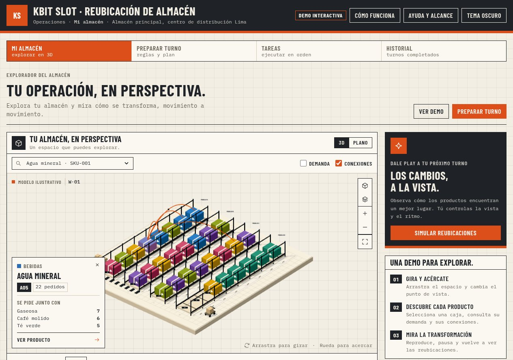
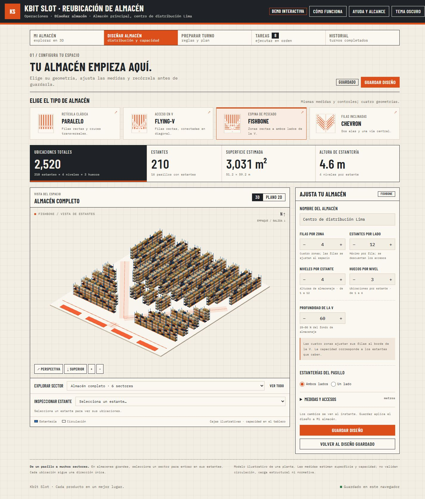

# Kbit Slot

Prototipo personal de software para explorar un almacén en 3D, simular reubicaciones y ejecutar tareas. Proyecto separado de `kbit-ibm/demo`; el repositorio original no se modifica.



**Demostración rápida:** abre `dist/Kbit-Slot.html` en un navegador y entra en **Diseñar almacén**. Elige una plantilla, ajusta estantes y niveles y guarda el diseño para verlo en **Mi almacén**. La simulación de reubicaciones sigue disponible como operación de ejemplo.

## Diseñador de almacenes



- Cuatro bases: Compacto (96 ubicaciones), Distribución (1.728), Fulfillment (21.600) y Estantería alta (5.120).
- Configura pasillos, estantes por lado, niveles, huecos y uno o ambos lados. Ajusta ancho de pasillos, ancho y fondo de estantes, altura entre niveles y frecuencia de cruces.
- La capacidad, superficie estimada y altura se actualizan junto al modelo 3D. Cambia a plano 2D, vista superior o perspectiva; gira, acerca y selecciona estantes.
- Por encima de 400 estantes se muestra una vista por sectores. Entra en uno desde el modelo o el selector para ver hasta 80 estantes detallados.
- Cada ubicación tiene una dirección estable: `P09-I-E11-N06-U03` identifica pasillo, lado, estante, nivel y hueco.
- **Guardar diseño** lo aplica a Mi almacén y lo conserva en este navegador. **Volver al diseño guardado** descarta el borrador; cambiar de página o de tema conserva el borrador válido durante la sesión.

El modelo representa una sola planta. Las cajas ilustran el espacio: no representan inventario ni ocupación real. La superficie incluye márgenes y una zona de empaque ilustrativa; no es un plano constructivo ni una validación normativa. El límite del configurador es 64 pasillos × 100 estantes por lado × 2 lados × 12 niveles × 6 huecos = 921.600 ubicaciones teóricas. Esto valida la representación compacta, no el rendimiento de un WMS u optimizador industrial.

El diseño personalizado se guarda separado de la operación de ejemplo de 30 SKUs / 32 posiciones. Todavía no alimenta el motor de reubicación; esta distinción aparece en la interfaz.

## Experiencia visual 3D

- Almacén ilustrativo con estantes, cajas, pasillos, zona de empaque y una carretilla de referencia.
- Arrastra para girar, usa la rueda o los botones para acercarte y cambia entre vista isométrica y superior.
- Amplía el almacén; usa la X o Escape para volver a la aplicación.
- Selecciona una caja o elige un producto en el buscador para consultar su ubicación y presencia en pedidos.
- Activa **Conexiones** para ver productos que se piden juntos y su frecuencia.
- Activa **Demanda** para colorear los productos por presencia en pedidos; la leyenda muestra la escala.
- Filtra por familia para destacar un grupo de productos.
- Reproduce, pausa, acelera (1×, 2×, 3×) y reinicia la simulación. Las cajas recorren una secuencia ilustrativa de movimientos, incluidos los pasos temporales.
- Cambia a **Plano** para volver a las 32 ubicaciones en 2D.
- Alterna **Tema oscuro / Tema claro** desde la cabecera; la escena 3D usa los mismos colores del tema y la preferencia se guarda en el navegador.

La reproducción es una demostración visual: no confirma movimientos ni modifica las tareas del turno. La geometría 3D es ilustrativa y los recorridos no representan un sistema físico de navegación. La experiencia está centrada en el frontend, con datos y estado locales. Requiere WebGL para 3D; el plano 2D permite continuar cuando WebGL no está disponible.

## Abrir

La forma más sencilla: abre **`dist/Kbit-Slot.html`** en tu navegador. Es un archivo independiente, con el diseño, la tipografía y la aplicación incluidos. No requiere instalación.

Para trabajar con los archivos de desarrollo, necesitas Node.js, sin instalar dependencias:

```powershell
npm start
```

Abre http://127.0.0.1:4173. La persistencia al abrir archivos locales depende de ese navegador. Regenera el archivo independiente con `npm run export` después de editar el proyecto.

## Flujo para presentar

1. **Mi almacén:** 30 productos, 32 posiciones y 180 pedidos sintéticos precargados. Selecciona una ubicación para inspeccionar el producto.
2. **Preparar turno:** limita a 2–12 productos reubicados, fija productos y conserva la zona de limpieza en el pasillo D.
3. **Generar plan:** calcula una propuesta, compara la distribución actual con la propuesta y revisa los productos reubicados.
4. **Tareas:** confirma movimientos en secuencia. Los destinos están libres y D08 actúa como reserva para intercambios temporales.
5. **Historial:** el turno completado se registra. Recarga para verificar que tu estado se conserva.

En Ayuda puedes reiniciar la demostración. La importación CSV acepta `order_id,sku` o `pedido_id,producto_id`, con separador coma o punto y coma. Cada pedido puede ocupar varias filas; los SKUs corresponden al catálogo de ejemplo (SKU-001 a SKU-030). Se admiten hasta 2 MB y 5.000 filas. Se puede descargar un CSV de ejemplo, el catálogo y las tareas.

## Alcance

- Prototipo funcional de una aplicación web, sin servidor de negocio. El archivo independiente y la carpeta `dist/` ya incluyen el motor visual empaquetado; no requieren instalar paquetes para usarlos.
- Los cálculos son reales sobre los pedidos activos. El motor usa una búsqueda local clásica independiente, intercambios y movimientos a posiciones libres. Respeta reglas y selecciona mejoras; no garantiza óptimo global.
- El índice suma, una vez por par, la frecuencia de aparición conjunta × distancia por pasillos. Los cruces entre pasillos se realizan por los extremos. Las distancias se expresan en unidades del plano, sin calibración a metros.
- El límite cuenta SKUs cuya ubicación final cambia; una reubicación puede necesitar pasos temporales adicionales.
- D08 queda reservado para movimientos temporales. Los productos de limpieza se mantienen en D cuando la regla está activa.
- El porcentaje es mejora del índice, no ahorro de tiempo, dinero o productividad comprobado.
- Catálogo, plano y pedidos iniciales son sintéticos. La importación cambia solo los pedidos, manteniendo el plano y el catálogo demo.
- Persistencia en `localStorage`, separada por navegador y origen. Los archivos CSV se procesan localmente. El historial y las confirmaciones no se sincronizan con otros usuarios.
- No incluye WMS, inventario de cantidades, autenticación, lectores QR ni Qiskit. Esas integraciones son trabajo posterior.

## Estructura

- `dist/index.html`: estructura de la aplicación.
- `dist/styles.css`: diseño responsive tipo plancha de despacho: tokens de color claro y oscuro, papel milimetrado, paneles con rótulo y tablero de solapas.
- `dist/app.js`: navegación, reglas, tareas, importación, exportación e historial.
- `dist/visual-ui.js` y `dist/visual.css`: controles, selección, capas y reproductor visual.
- `src/warehouse3d.js`: escena Three.js, interacción, cámara, iluminación y animación.
- `src/layout3d.js`: vista configurable con geometría instanciada, selección y detalle por sectores.
- `dist/layout-model.js`: validación, capacidad, geometría lógica, sectores y direcciones.
- `dist/designer.js` y `dist/designer.css`: configurador, plano 2D y persistencia del diseño.
- `dist/warehouse3d.js`: motor visual empaquetado para uso sin conexión.
- `dist/engine.js`: datos, objetivo, optimización y secuencias de movimiento. Acepta otros planos (pasillos, posiciones, niveles, reservas) y zonas por familia; el formato está en `docs/CONTRATO-MOTOR.md`.
- `server.mjs`: servidor estático local sin dependencias.
- `tests/engine.test.cjs`: validaciones del motor y del CSV.
- `tests/layout.test.cjs`: capacidad, direcciones únicas, cobertura de sectores y límites del modelo.

Ejecutar verificaciones:

```powershell
npm test
```

Para modificar y recompilar la escena 3D:

```powershell
npm ci
npm run build
npm run export
```

Tipografías Barlow Condensed e IBM Plex Mono (subconjunto latino, woff2) con sus licencias OFL y Three.js con licencia MIT en `dist/assets/`.
